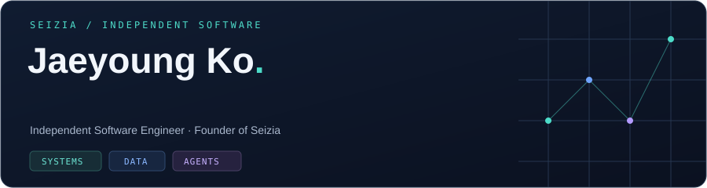
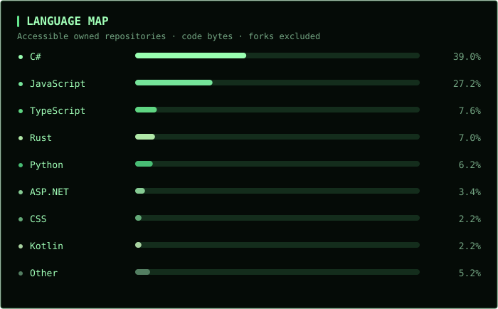

<picture>
  
</picture>

### `> whoami`

Independent software engineer and founder of **[Seizia](https://seizia.com)**. I build practical software with a focus on usability, data workflows, and communication between agents.

**Primary database expertise: Microsoft SQL Server (MSSQL).**

### `> toolbox`

Technologies I've worked with, across current and past projects.

**Languages**

**Applications**

**Data**

**Infrastructure**

### `> projects`

| Product | What I'm building |
| :--- | :--- |
| **[Turbrix](https://turbrix.com)** | Visual workflows for data extraction, transformation, and analysis. |
| **[Brevduva](https://brevduva.dev)** | Messaging infrastructure for communication between agents. |
| **Seizia** | Independent software built around practical needs. |

### `> engineering`

Make complex tools easy to use. Understand how systems work. Build with care.

### `> language-map`

<picture>
  
</picture>

Measured by code bytes across accessible repositories I own, including private repositories once connected. Forks and this profile repository are excluded. This measures code composition, not proficiency or time spent.

---

[Website](https://seizia.com) · [Brevduva](https://brevduva.dev) · [Turbrix](https://turbrix.com)

